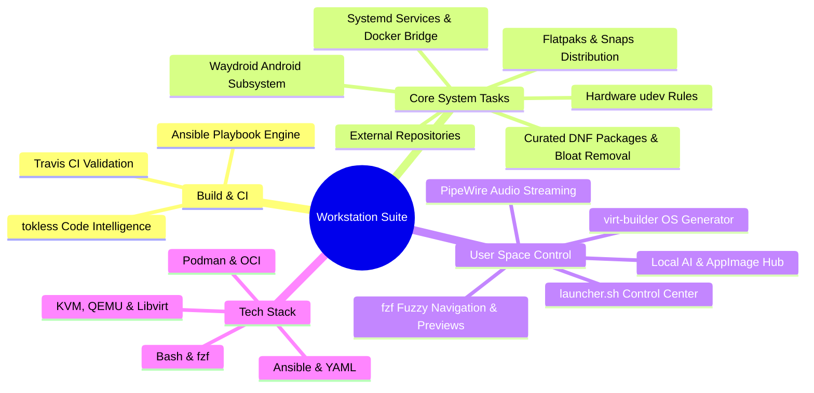
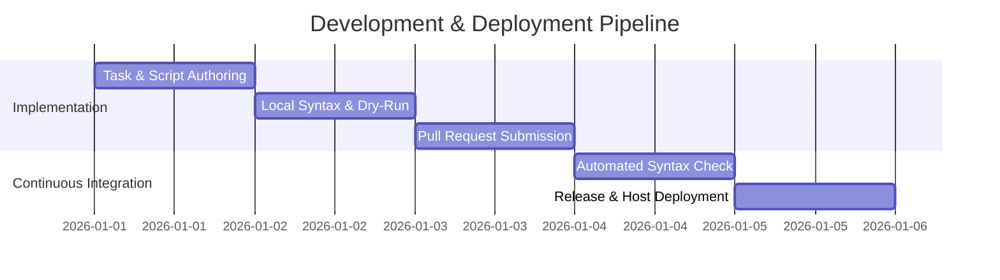

<div align="center">

# Fedora Workstation Post-Install Suite

### Seamless post-install automation, developer orchestration, and interactive control center for Fedora Workstation.

[](LICENSE)
[](#)
[](#)
[](#)

</div>

---

## What Is This Project?

**Fedora Workstation Post-Install Suite** is a declarative **Ansible-based workstation orchestrator and terminal control center** built around Apple Human Interface Guidelines: **Clarity**, **Deference**, and **Depth**.

It automates the transition from a stock Fedora installation to a production-grade development system in a single command—configuring repositories, development toolchains, rootless container bridges, kernel virtualization stacks, and user-space enhancements with zero manual friction.

---

## Architecture

The mindmap below outlines the architectural hierarchy and separation between root system provisioning and unprivileged user-space workflows:



---

## Why Does It Exist?

Manually provisioning a fresh Fedora workstation requires repetitive, error-prone configuration across fragmented package ecosystems (DNF, Flathub, Snapcraft, AppImages), virtualization settings, and shell environments. 

This project delivers a **reproducible, declarative workstation standard** that:

> [!NOTE]
> **Core Engineering Tenets**
> * **Strict Privilege Boundary**: Elevated (`sudo`) system-level provisioning is strictly decoupled from unprivileged user environments (`launcher.sh`).
> * **Cognitive Deference**: UI tools emphasize content over chrome; `fzf` fuzzy filtering and live preview panels reduce mental overhead.
> * **Reproducible Infrastructure**: Version-controlled VM templates, Vagrant sandboxes, and Ansible plays allow identical environments across machines.

---

## How It Works

The suite executes a 12-stage sequential pipeline against the local workstation, configuring official repositories, upgrading base packages, establishing container runtime sockets, and provisioning hardware access rules.

Once provisioned, users interact with the system via `launcher.sh`—an interactive terminal control center utilizing **Apple HIG design patterns** (rounded borders, high-contrast indicators, right-anchored inspector previews, and modal confirmations).

### Technology Breakdown

| Technology | Role | Purpose |
| :--- | :--- | :--- |
| **Ansible** | Orchestration | Declarative task automation, idempotency, and host configuration |
| **Fedora Linux** | Host Platform | Modern Linux workstation base with DNF, systemd, and Btrfs |
| **fzf** | User Interface | Fuzzy searching, live inspector sidebars, and keyboard ergonomics |
| **KVM / QEMU / Libvirt** | Hypervisor | Hardware-accelerated virtual machines, bridge networking, and `virt-builder` |
| **Podman** | Containers | Rootless container engine with `/var/run/docker.sock` API bridge |
| **Waydroid** | Android Subsystem | Containerized LineageOS with libndk ARM translation and Widevine DRM |
| **Homebrew & Pixi** | Package Managers | Unprivileged command-line developer tools and Conda environments |
| **ujust & Starship** | Terminal Experience | Universal Blue task runner, terminal bling, and cross-shell prompt |

---

## Repository Structure

<details>
<summary><strong>View project file tree</strong></summary>

```text
Ansible-Playbook-Fedora-Workstation/
├── local.yml                      # Main playbook definition and variable toggles
├── handlers/
│   └── main.yml                   # System handlers (udev rules reload)
├── tasks/
│   ├── repositories.yml           # External YUM/DNF repository configurations
│   ├── update.yml                 # System package upgrades
│   ├── packages.yml               # DNF packages, bloat removal & Pinokio RPM
│   ├── flatpaks.yml               # Flathub & Fedora OCI Flatpak applications
│   ├── snaps.yml                  # Classic & standard confinement Snap applications
│   ├── services.yml               # Systemd services, sockets, firewalld & libvirt defaults
│   ├── udev.yml                   # Gamepad, joystick & VR udev rules
│   ├── waydroid.yml               # Waydroid integration, Polkit rules & defaults
│   ├── homebrew.yml               # Unprivileged Linuxbrew installation & PATH
│   ├── users-groups.yml           # User accounts, groups & desktop launcher deployment
│   ├── ujust.yml                  # ujust recipes, Starship prompt & Bluefin bling
│   └── initialize.yml             # System hostname, AppImages dir & virtualization paths
├── launcher.sh                    # HIG-compliant interactive user control center (fzf)
├── Scripts/
│   ├── packages.sh                # Core DNF package installation script
│   └── user.sh                    # Helper to launch shell as unprivileged desktop user
├── files/
│   ├── udev/                      # Hardware udev rule definitions (*.rules)
│   ├── ujust/                     # Bluefin ujust task recipes, bling scripts & configs
│   └── waydroid/                  # Bazzite Waydroid container scripts, GPU tool & Polkit
├── VMs/                           # Libvirt KVM guest XML templates
│   ├── Android.xml
│   ├── Linux.xml
│   └── Windows.xml
├── Vagrant/
│   ├── ubuntu/                    # Ubuntu 24.04 LTS desktop libvirt VM
│   └── yunohost/                  # Debian 12 YunoHost self-hosting testbed
├── logs/                          # Installation logs directory
├── travis.yml                     # Syntax validation CI configuration
├── LICENSE                        # Repository license
└── README.md                      # Documentation
```

</details>

---

## Development Workflow

The development lifecycle follows a strict review, lint, and verification pipeline:



---

## How to Run Locally

<details open>
<summary><strong>Quickstart Instructions</strong></summary>

### 1. Prerequisites
Ensure Ansible and Git are available:
```bash
sudo dnf install -y ansible git
```

### 2. Clone Repository
```bash
git clone https://github.com/AIJosue/Ansible-Playbook-Fedora-Workstation.git
cd Ansible-Playbook-Fedora-Workstation
```

### 3. Verify & Execute Playbook
Run syntax check, then execute the declarative setup (full playbook or selective tags):
```bash
ansible-playbook local.yml --syntax-check
ansible-playbook local.yml --ask-become-pass
# Or run specific sections using tags:
ansible-playbook local.yml --tags ujust --ask-become-pass
```

### 4. Launch User Control Center
Access the HIG-styled interactive utility anytime:
```bash
./launcher.sh
```

> [!TIP]
> Run `./launcher.sh --help` to list all direct non-interactive CLI flags (e.g. `--playbook`, `--ujust`, `--virt-builder`, `--waydroid`, `--libvirt-net`, `--appimages`, `--devpod`, `--dory`, `--prism`, `--localai`, `--updatetool`).

### 5. AppImage Hub & Local AI Engines
The AppImage Hub menu (`./launcher.sh --appimages`) provisions and manages standalone AppImages and local AI inference suites in `~/AppImages`:
* **Development & Tools**: DevPod (`~/.local/bin/devpod`), AppImageUpdate tool, Bionic, Darktable, Eden, Jan, LMMS, MuseScore Studio, QtScrcpy, Unsloth.
* **Local Inference Engines**:
  * **llama-prism**: Pre-compiled multi-backend llama.cpp binaries (CUDA, Vulkan, ROCm, SYCL, CPU) from PrismML.
  * **llama-dory**: Nemotron-Dory llama.cpp engine with loop/recurrent cache launch script.
  * **LocalAI**: Native binaries and containerized local model inference.
  * **KoboldCpp**: Single-file LLM inference executable.


</details>

---

## License

This project is licensed under the [MIT License](LICENSE).
