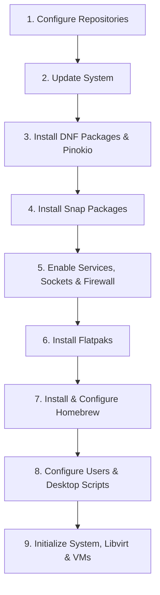

# Ansible Post-Install Playbook for Fedora Workstation

An automated **Ansible playbook** designed for rapid, reproducible post-installation configuration of Fedora Workstation. Rather than manually configuring repositories, system utilities, virtualization stacks, software packages, and user profiles, this playbook provisions a fully functional development and productivity workstation in a single run.

---

## Key Features

- **Automated Repository Setup**: Configures official third-party repositories for Google Chrome, Microsoft Edge, Microsoft Teams, ProtonVPN, VS Code, and Zoom.
- **Comprehensive DNF Curation**: Cleans up unwanted default packages and provisions development toolchains, container engines, HashiCorp IaC tooling, 3D printing tools, and KDE Plasma theming.
- **Multi-Format Software Distribution**: Integrates native **DNF** packages, **Snap** applications (classic and standard confinement), and **Flatpak** applications (from both Flathub and Fedora OCI remotes).
- **Automated Pinokio RPM Management**: Auto-fetches, installs, and updates the latest release of [Pinokio](https://pinokio.computer/) directly from GitHub releases.
- **Enterprise-Ready Virtualization & Containers**: Pre-configures KVM/QEMU, Libvirt (with default bridge network & VM templates), Podman (with Docker socket compatibility), Cockpit web console, and Vagrant.
- **Separation of System & User Concerns**: Deploys an interactive desktop setup utility (`launcher.sh`) allowing users to configure Homebrew, Pixi, Distrobox containers, and terminal caches on demand.
- **Reproducible Testbeds**: Includes Vagrant definitions for an Ubuntu 24.04 LTS libvirt desktop VM and a self-contained Debian 12 YunoHost server.

---

## Prerequisites

- **Operating System**: Fedora Workstation
- **Ansible**: Installed locally on the host:
  ```bash
  sudo dnf install -y ansible
  ```
- **Privileges**: Elevated (`sudo`) access for system-level tasks.

---

## Quickstart

1. **Clone the repository**:
   ```bash
   git clone https://github.com/ITJosue/Ansible-Playbook-Fedora-Workstation.git
   cd Ansible-Playbook-Fedora-Workstation
   ```

2. **Configure playbook variables** (optional):
   Edit `local.yml` to set your desired system hostname and virtualization directories:
   ```yaml
   vars:
     hostname: "Desktop"                                       # Set desired system hostname
     xml_dir: "$HOME/virtualization/kvm-qemu"                 # Path to VM XML template definitions
     vagrant_dir: "$HOME/virtualization/vagrant"              # Path to Vagrant environment folders
   ```

3. **Verify syntax**:
   ```bash
   ansible-playbook local.yml --syntax-check
   ```

4. **Execute the playbook**:
   ```bash
   sudo ansible-playbook local.yml
   ```

---

## Playbook Execution Pipeline

The playbook runs sequentially through 9 structured stages defined in `tasks/`:



### 1. Repositories (`tasks/repositories.yml`)
Configures trusted external YUM/DNF repositories with GPG verification:
- **Google Chrome** (`google-chrome`)
- **Microsoft Edge** (`microsoft-edge`)
- **Microsoft Teams** (`ms-teams-yum`)
- **ProtonVPN** (`protonvpn-fedora-stable`)
- **Visual Studio Code** (`vscode-yum`)
- **Zoom** (`zoom-release`)
*(HashiCorp stable/test repositories are available for activation if needed)*.

### 2. System Update (`tasks/update.yml`)
Upgrades all installed packages across the system using `dnf` to guarantee a clean, current base before installing dependencies.

### 3. DNF Packages & Removal (`tasks/packages.yml` & `Scripts/packages.sh`)
- **Removes default bloat**: Akregator, KDE PIM suite, LibreOffice, Dragon Player, KCalc, KWrite, NeoChat, Okular, default Toolbox, and Blender.
- **Installs curated toolchains and packages**:
  - **Virtualization & Containers**: `@virtualization`, `virt-manager`, `gnome-boxes`, `qemu-img`, `swtpm`, `libguestfs`, `nbdkit`, `podman`, `podman-compose`, `podman-docker`, `podman-machine`, `podman-remote`, `podman-tui`, `buildah`, `skopeo`, `flatpak-builder`, `distrobox`.
  - **IaC & HashiCorp**: `boundary`, `packer`, `terraform`, `terraform-ls`, `terraform-stacks-cli`, `vagrant`, `vagrant-libvirt`, `vagrant-cachier`, `vagrant-sshfs`, `vagrant-hostmanager`, `vagrant-registration`, `waypoint`.
  - **Development & Compilers**: `@development-tools`, `clang`, `cmake`, `gh` (GitHub CLI), `git-lfs`, `godot`, `nix`, `nix-daemon`, `nodejs`, `gtk3-devel`, `libva-utils`, `strace`, `tmux`, `uv`, `conda`, `DisplayCAL`, `corectrl`.
  - **Browsers & AI**: `google-chrome-stable`, `microsoft-edge-stable`, **Pinokio** (dynamically discovers the latest release RPM from GitHub releases and installs or updates it).
  - **Hardware & 3D Printing**: `prusa-slicer`.
  - **System Utilities & Shells**: `7zip`, `android-tools`, `bleachbit`, `btrfs-assistant`, `gnome-disk-utility`, `snapd`, `fastfetch`, `tldr`, `fish`, `zsh`.
  - **Networking & Security**: `fail2ban` (with firewalld and systemd integration), `wireguard-tools`, `nmap-ncat`.
  - **Media & Fonts**: `calibre`, `clementine`, `ffmpegthumbnailer`, Google Noto Fonts (`google-noto-fonts-all`, `google-noto-color-emoji-fonts`), Inter Fonts (`rsms-inter-fonts`).
  - **Communication**: `zoom`, `pidgin`, `pidgin-otr`.
  - **KDE Plasma & Desktop Customization**: `kate`, `krusader`, `kompare`, `ksystemlog`, `kcron`, `kclock`, `ktimer`, `kmousetool`, `krename`, `krdc`, Dolphin plugins, thumbnailers, Kvantum, Arc KDE, QtCurve, Materia, Aurorae, SDDM themes, and Plasma applets.

### 4. Snap Packages (`tasks/snaps.yml`)
Configures the `/snap` directory symlink and deploys applications across standard and classic confinement:
- **Standard**: `audacity`, `bitwarden`, `chromium`, `cups`, `digikam`, `firefox`, `freecad`, `gimp`, `gnome-characters`, `inkscape`, `k3b`, `kget`, `node-red`, `nordvpn`, `obs-studio`, `openvino-ai-plugins-gimp`, `postman`, `proton-vpn`, `snap-store`, `steam`, `tailscale`, `telegram-desktop`, `termius-app`.
- **Classic (`--classic`)**: `antigravity`, `blender`, `code` (VS Code), `flutter`, `powershell`.

### 5. Services, Sockets & Firewall (`tasks/services.yml`)
- **Systemd Services**: Enables and starts `libvirtd`, `fail2ban`, `nix-daemon`, `sshd`, and `tailscaled`.
- **Systemd Sockets**: Enables and starts `podman.socket`, `cockpit.socket`, and `snapd.socket`.
- **Docker Socket Bridge**: Creates a symlink from `/run/podman/podman.sock` to `/var/run/docker.sock` to ensure seamless compatibility with Docker-dependent CLI tools and workflows.
- **Firewall (`firewalld`)**: Enables `firewalld` and opens permanent ports/services for `ssh`, `cockpit`, and `kdeconnect`.

### 6. Flatpaks (`tasks/flatpaks.yml`)
Registers the Flathub and Fedora OCI remotes, then installs desktop applications:
- **Web Browsers**: Brave Browser (`com.brave.Browser`), Zen Browser (`app.zen_browser.zen`).
- **Productivity & Notes**: Collabora Office, XMind, Anki, Anytype, Ente Auth, Merkuro Calendar, KDE Itinerary, Tellico, Francis Pomodoro.
- **Media, Audio & Streaming**: Kdenlive, HandBrake, Kodi, Haruna, Glaxnimate, Kid3, KST, LabPlot, Sunshine (low-latency game streaming server), Moonlight (game streaming client), fcast Receiver.
- **Creative & 3D**: Krita, RapidRAW, Bambu Studio (`com.bambulab.BambuStudio`), Neothesia, GNOME Snapshot.
- **Gaming & Compatibility**: Bottles (`com.usebottles.bottles`), Lutris, Sober (Roblox runtime for Linux).
- **Utilities & System Tools**: LocalSend, PeaZip, KeePassXC, PikaBackup, Warehouse (Flatpak manager), GearLever (AppImage manager), Podman Desktop, Apx GUI (Vanilla OS container manager), DistroShelf, Evince, GNOME Firmware, GNOME Maps, GNOME Weather, Icon Library, MetadataCleaner, EasyEffects, JamesDSP (`jdsp4linux`), Crow Translate, Nicotine+, qBittorrent, Cantor, Drawy, Kodaskanna, Kalk, Kalm.
- **Fedora Flatpak Remote**: Clementine, Evolution, Meld, ROCs.

### 7. Homebrew / Linuxbrew (`tasks/homebrew.yml`)
- Installs Homebrew non-interactively using the unprivileged user (`become_user: "{{ ansible_env.SUDO_USER | default(ansible_env.USER) }}"`).
- Establishes system-wide PATH profile loading via `/etc/profile.d/homebrew.sh`.
- Adds `brew shellenv` evaluation to the user's `~/.bashrc`.

### 8. Users, Groups & Desktop Automation (`tasks/users-groups.yml`)
- Ensures required system groups exist (`wheel`, `libvirt`, `nordvpn`, `render`, `video`).
- Provisions and adds accounts to necessary groups:
  | User | Primary Groups | Purpose |
  |---|---|---|
  | **Sudo / Invoking User** | `wheel`, `libvirt`, `lxd`, `nordvpn`, `render`, `video` | Administrative workstation operator |
  | **`admin`** | `wheel`, `libvirt`, `nordvpn`, `render`, `video` | Secondary administrative account |
  | **`user`** | `libvirt`, `render`, `video` | Unprivileged standard desktop user |
- Sets up user `~/Desktop` directories and deploys the onboarding utility:
  - `~/Desktop/launcher.sh`

#### Interactive User Environment Utility (`launcher.sh`)
Maintains clean isolation between root-level provisioning and user-level developer settings. Can be executed in the terminal with flags:
```bash
~/Desktop/launcher.sh [FLAG]
```

| Flag | Menu Option | Action |
|---|---|---|
| `--brew` | `1) Configure Homebrew Environment` | Detects Homebrew or guides installation, adding `shellenv` to `~/.bashrc` and `~/.zshrc`. |
| `--pixi` | `2) Install Pixi Package Manager` | Installs [Pixi](https://pixi.sh) via official script and exports `~/.pixi/bin` to shell PATH. |
| `--terminal` | `3) Update TLDR & Terminal Utilities` | Updates `tldr` cache, rebuilds `bat` syntax cache, initializes `git-lfs` user hooks, flushes font cache (`fc-cache`), and updates man database (`mandb`). |
| `--distrobox` | `4) Create Ubuntu Distrobox Container` | Provisions an `ubuntu-toolbox` container using `quay.io/toolbx/ubuntu-toolbox:latest` with overwrite confirmation and runs an initial startup pass. |
| `--all` | `5) Install / Configure All` | Runs all 4 onboarding stages sequentially. |

### 9. System Initialization & Virtualization (`tasks/initialize.yml`)
- Configures system hostname.
- Creates `~/AppImages` directory for portable standalone applications.
- Creates user virtualization directories:
  - Pushes KVM/QEMU XML templates (`VMs/*.xml`) to `$HOME/virtualization/kvm-qemu`
  - Pushes Vagrant environment folders (`Vagrant/ubuntu`, `Vagrant/yunohost`) to `$HOME/virtualization/vagrant`
- Enables and autostarts the **libvirt default bridge network** (`virsh net-autostart default`).
- Defines hardware-accelerated KVM virtual machines from `$HOME/virtualization/kvm-qemu/*.xml`:
  - `Android.xml` — Android-x86 virtualization template
  - `Linux.xml` — Standard Linux guest template
  - `Windows.xml` — Windows 10/11 guest template with VirtIO drivers

---

## Testing & Vagrant Environments

The repository contains pre-configured Vagrant environments for testing and self-hosting:

### Ubuntu 24.04 LTS Desktop VM (`Vagrant/ubuntu/Vagrantfile`)
A libvirt/KVM Vagrant definition for spinning up an Ubuntu 24.04 LTS (Noble Numbat) workstation equipped with SPICE graphics, tablet input, TPM 2.0 emulator, and minimal desktop environment (`ubuntu-desktop-minimal`):
- **Specs**: 8 GB RAM, 12 vCPUs, host-passthrough CPU mode, Q35 machine type, ICH9 sound.
- **Display & Input**: VirtIO video, SPICE graphics, USB tablet input, and USB redirection.

**Actions Supported:**
- **Start**: `vagrant up --provider=libvirt`
- **SSH**: `vagrant ssh`
- **Open graphical console**: `virt-manager`

```bash
cd Vagrant/ubuntu
vagrant up --provider=libvirt
vagrant ssh
```

### YunoHost Debian 12 Environment (`Vagrant/yunohost/Vagrantfile`)
A self-contained testbed for deploying [YunoHost](https://yunohost.org) on Debian 12 (Bookworm) via libvirt with automated non-interactive post-installation:
- **Specs**: 8 GB RAM, 12 vCPUs, host-passthrough CPU mode, Q35 machine type, 32 GB disk.
- Automatically installs base dependencies, installs YunoHost, and completes post-installation (`yunohost tools postinstall`).

```bash
cd Vagrant/yunohost
vagrant up --provider=libvirt
vagrant ssh
```

---

## Repository Structure

```
Ansible-Playbook-Fedora-Workstation/
├── local.yml                      # Main playbook entry point
├── tasks/
│   ├── repositories.yml           # External YUM/DNF repository setup
│   ├── update.yml                 # Base system upgrade
│   ├── packages.yml               # DNF cleanup, installation, and Pinokio RPM logic
│   ├── snaps.yml                  # Classic and standard Snap packages
│   ├── services.yml               # Systemd services, sockets, firewall rules
│   ├── flatpaks.yml               # Flathub and Fedora Flatpak applications
│   ├── users-groups.yml           # Users, groups, and desktop setup launchers
│   ├── initialize.yml             # Hostname, AppImages dir, libvirt network & VMs
│   └── homebrew.yml               # Unprivileged Homebrew installation & PATH
├── Scripts/
│   ├── packages.sh                # Core DNF package installation script
│   └── launcher.sh                # Interactive user post-install onboarding script
├── VMs/                           # Libvirt KVM guest XML templates
│   ├── Android.xml
│   ├── Linux.xml
│   └── Windows.xml
├── Vagrant/
│   ├── ubuntu/                    # Ubuntu 24.04 LTS desktop libvirt VM
│   │   └── Vagrantfile
│   └── yunohost/                  # Debian 12 YunoHost self-hosting testbed
│       └── Vagrantfile
├── logs/                          # Installation log output directory
├── travis.yml                     # CI syntax validation configuration
├── LICENSE                        # Project license
└── README.md                      # Project documentation
```

---

## Customization Tips

- **Add or Remove Packages**: Modify package lists in `tasks/flatpaks.yml`, `tasks/snaps.yml`, or `Scripts/packages.sh`.
- **Change Default Hostname**: Update `hostname: "Desktop"` in `local.yml`.
- **Toggle Task Sections**: Comment out or reorder `include_tasks` entries in `local.yml`.
- **HashiCorp Repositories**: Uncomment HashiCorp repo definitions in `tasks/repositories.yml` if you prefer package managers over binary distributions.
- **User Accounts**: Adjust usernames and supplemental groups in `tasks/users-groups.yml`.

---

## License

This project is licensed under the terms described in [LICENSE](LICENSE).
