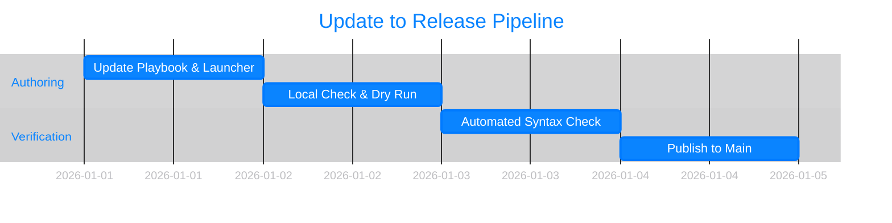

<div align="center">

[](#what-is-this-project)

<br>

<h1 align="center">Fedora Workstation Post-Install Suite</h1>

<p align="center">
  <b>Turn a fresh Fedora install into a complete, ready-to-use workstation in minutes — no manual tweaking required.</b>
</p>

<p align="center">
  <a href="LICENSE"></a>
  <a href="#development-workflow"></a>
  <a href="#how-it-works"></a>
  <a href="#architecture"></a>
  <a href="#how-to-run-locally"></a>
</p>

<p align="center">
  <a href="#how-to-run-locally">Quick Start</a> • 
  <a href="#architecture">Architecture</a> • 
  <a href="#how-it-works">Capabilities</a> • 
  <a href="#repository-structure">Structure</a> • 
  <a href="#development-workflow">Workflow</a>
</p>

</div>

<br>

> [!NOTE]
> **All-in-One Setup & Control Center:** `local.yml` provisions your system once, while `./launcher.sh` gives you an everyday, menu-driven dashboard inspired by Apple Human Interface Guidelines.

<br>

<h2 align="center">What Is This Project?</h2>

**Fedora Workstation Post-Install Suite** is an all-in-one setup assistant and everyday **Control Center (`launcher.sh`)** for Fedora Linux.

Instead of spending hours hunting down installers, tweaking system settings, or memorizing terminal commands, you get a single automated setup followed by a clean, menu-driven dashboard. Whether you want creative apps, Android apps on your desktop, virtual machines, or private offline AI tools, everything is organized into simple, guided choices.

<br>

<table width="100%">
  <tbody>
    <tr>
      <td width="33%" align="center" valign="top">
        <h2>⏱️</h2>
        <p><b>Saves Hours of Setup</b></p>
        <p>Installs core apps, Flatpaks, Snaps, Homebrew tools, and system updates in a single automated pass.</p>
      </td>
      <td width="33%" align="center" valign="top">
        <h2>🧭</h2>
        <p><b>Keeps Things Simple</b></p>
        <p>Replaces complex terminal commands with clean, interactive menus you navigate with <kbd>↑</kbd> <kbd>↓</kbd> and <kbd>Return ⏎</kbd>.</p>
      </td>
      <td width="33%" align="center" valign="top">
        <h2>🎛️</h2>
        <p><b>Respects Your Choices</b></p>
        <p>Run everything at once, pick individual roles, or easily customize paths and themes inside <code>launcher.sh</code>.</p>
      </td>
    </tr>
  </tbody>
</table>

<br>

## Architecture

The diagram below shows how the suite separates behind-the-scenes system setup from your everyday Control Center:

```mermaid
%%{init: {
  'theme': 'base',
  'themeVariables': {
    'fontFamily': 'Inter, -apple-system, BlinkMacSystemFont, SF Pro Display, sans-serif',
    'primaryColor': '#0A84FF',
    'primaryTextColor': '#FFFFFF',
    'primaryBorderColor': '#007AFF',
    'secondaryColor': '#5E5CE6',
    'tertiaryColor': '#30D158',
    'lineColor': '#8E8E93',
    'textColor': '#F2F2F7',
    'mainBkg': '#1C1C1E',
    'nodeBorder': '#48484A'
  }
}}%%
mindmap
  root((Fedora Workstation Suite))
    Automated Setup
      DNF & System Updates
      Flatpak, Snap & Homebrew
      Hardware & System Tweaks
    Everyday Control Center
      Interactive TUI Dashboard
      Quick CLI Shortcuts
      Auto-Detect Light/Dark Mode
    Play & Create
      Android Apps via Waydroid
      Minecraft via Prism Launcher
      Private Offline AI
    Build & Share
      Virtual Machines & Sandboxes
      AppImage & Script Launcher
      Local Web Tools via Dory
```



<br>

## How It Works

Each role in `local.yml` and each module in `launcher.sh` works together to cover your entire workstation experience.

<table width="100%">
  <thead>
    <tr>
      <th align="left" width="25%">Capability</th>
      <th align="left" width="55%">What It Does</th>
      <th align="left" width="20%">Key Component</th>
    </tr>
  </thead>
  <tbody>
    <tr>
      <td><strong>Fedora Apps & System</strong></td>
      <td>Configures DNF, Flatpak, Snap, Homebrew, and core workstation packages.</td>
      <td><code>local.yml</code><br><code>roles/</code></td>
    </tr>
    <tr>
      <td><strong>VMs & Sandboxes</strong></td>
      <td>Pre-built Android, Linux & Windows VM definitions using <code>virt-builder</code>.</td>
      <td><code>vms/</code></td>
    </tr>
    <tr>
      <td><strong>Android Desktop</strong></td>
      <td>Runs Android apps seamlessly and manages GPU/ARM compatibility scripts.</td>
      <td><code>waydroid/</code><br><code>--waydroid</code></td>
    </tr>
    <tr>
      <td><strong>AppImage Manager</strong></td>
      <td>Scans and launches portable <code>.AppImage</code> applications and custom scripts.</td>
      <td><code>--appimages</code></td>
    </tr>
    <tr>
      <td><strong>Private Offline AI</strong></td>
      <td>Launches local AI tools securely without sending your data to the cloud.</td>
      <td><code>--localai</code></td>
    </tr>
    <tr>
      <td><strong>Control Center</strong></td>
      <td>Unified menu with Light/Dark mode and quick one-word CLI shortcuts.</td>
      <td><code>./launcher.sh</code></td>
    </tr>
  </tbody>
</table>

<br>

## Repository Structure

<details>
<summary><strong>Explore the full project layout</strong></summary>
<br>

```text
Ansible-Playbook-Fedora-Workstation/
├── launcher.sh                 # Interactive TUI Control Center & CLI shortcuts
├── local.yml                   # Master Ansible playbook for workstation provisioning
├── inventory                   # Localhost inventory target
├── roles/                      # Modular Ansible roles (apps, updates, tools)
├── vms/                        # Ready-to-import Android, Linux & Windows VM templates
├── waydroid/                   # Waydroid helper scripts & GPU tools
├── logs/                       # Setup logs
├── travis.yml                  # Automated syntax checks
├── LICENSE                     # Mozilla Public License 2.0
└── Readme.md                   # You are here
```

</details>

<br>

## Development Workflow

This timeline shows how updates are tested and delivered safely to your workstation:



<br>

## How to Run Locally

> [!TIP]
> **Fast One-Line Setup (Recommended):** Run this in your Fedora terminal to download everything and open the Control Center automatically:
> ```bash
> curl -SL https://github.com/AIJosue/Ansible-Playbook-Fedora-Workstation/raw/refs/heads/main/launcher.sh | bash
> ```

<br>

<details open>
<summary><strong>Step-by-Step Setup &amp; Customization</strong></summary>
<br>

**1. Install Prerequisites** 
Install `ansible`, `git`, and `gum` (powers the interactive menus):
```bash
sudo dnf install -y ansible git gum
```

**2. Download the Project**
```bash
git clone https://github.com/AIJosue/Ansible-Playbook-Fedora-Workstation.git
cd Ansible-Playbook-Fedora-Workstation
```

**3. Run the Automated Workstation Setup**
```bash
ansible-playbook local.yml --ask-become-pass
```
*Want only one part, like `ujust`? Run `ansible-playbook local.yml --tags ujust --ask-become-pass`.*

**4. Open the Control Center**
Launch your dashboard anytime:
```bash
./launcher.sh
```
*Run `./launcher.sh --help` for quick shortcuts like `--appimages`, `--waydroid`, `--dory`, `--prism`, `--localai`, `--virt-builder`, and `--ujust`.*

---

### Customizing Your Setup

Want your AppImages, VMs, or scripts stored in different folders, or prefer Light Mode? Open the **User Configuration** section at the very top of `launcher.sh` and change any value—or override it for a single run inline:

```bash
APPIMAGES_DIR=/opt/AppImages HIG_APPEARANCE=light ./launcher.sh
```

</details>

<br>

## License

This project is licensed under the [Mozilla Public License Version 2.0](LICENSE).