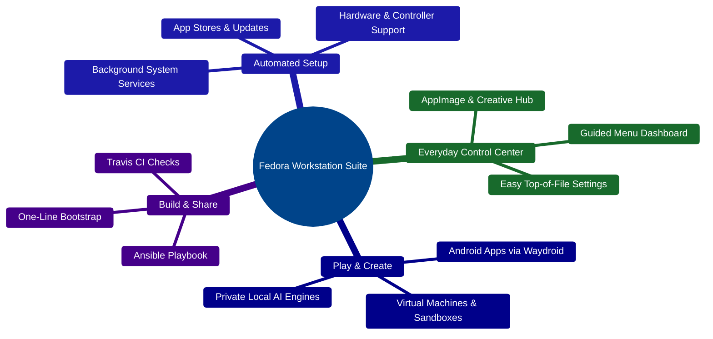
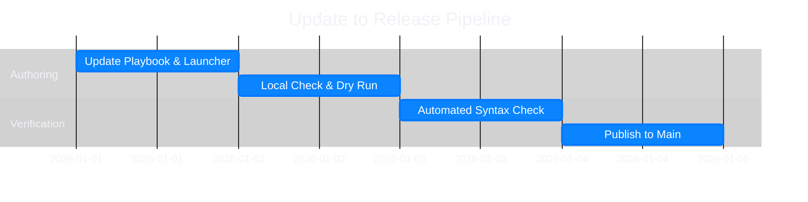

&lt;div align=&quot;center&quot;&gt;

&lt;br /&gt;

&lt;picture&gt;
  &lt;source media=&quot;(prefers-color-scheme: dark)&quot; srcset=&quot;https://img.shields.io/badge/Fedora_Workstation-Post--Install_Suite-0A84FF?style=for-the-badge&amp;logo=fedora&amp;logoColor=FFFFFF&amp;labelColor=1C1C1E&quot; /&gt;
  &lt;source media=&quot;(prefers-color-scheme: light)&quot; srcset=&quot;https://img.shields.io/badge/Fedora_Workstation-Post--Install_Suite-007AFF?style=for-the-badge&amp;logo=fedora&amp;logoColor=FFFFFF&amp;labelColor=F2F2F7&quot; /&gt;
  &lt;img alt=&quot;Fedora Workstation Post-Install Suite&quot; src=&quot;https://img.shields.io/badge/Fedora_Workstation-Post--Install_Suite-007AFF?style=for-the-badge&amp;logo=fedora&amp;logoColor=FFFFFF&amp;labelColor=1C1C1E&quot; /&gt;
&lt;/picture&gt;

&lt;h1&gt;Fedora Workstation Post-Install Suite&lt;/h1&gt;

&lt;p&gt;
  &lt;strong&gt;Turn a fresh Fedora install into a complete, ready-to-use workstation in minutes — no manual tweaking required.&lt;/strong&gt;
&lt;/p&gt;

&lt;p&gt;
  &lt;a href=&quot;https://www.google.com/search?q=LICENSE&quot;&gt;
    &lt;picture&gt;
      &lt;source media=&quot;(prefers-color-scheme: dark)&quot; srcset=&quot;https://img.shields.io/github/license/AIJosue/Ansible-Playbook-Fedora-Workstation?style=flat-square&amp;labelColor=1C1C1E&amp;color=8E8E93&quot; /&gt;
      &lt;source media=&quot;(prefers-color-scheme: light)&quot; srcset=&quot;https://img.shields.io/github/license/AIJosue/Ansible-Playbook-Fedora-Workstation?style=flat-square&amp;labelColor=E5E5EA&amp;color=636366&quot; /&gt;
      &lt;img alt=&quot;License&quot; src=&quot;https://img.shields.io/github/license/AIJosue/Ansible-Playbook-Fedora-Workstation?style=flat-square&amp;labelColor=1C1C1E&amp;color=8E8E93&quot; /&gt;
    &lt;/picture&gt;
  &lt;/a&gt;
  &lt;a href=&quot;#development-workflow&quot;&gt;
    &lt;picture&gt;
      &lt;source media=&quot;(prefers-color-scheme: dark)&quot; srcset=&quot;https://img.shields.io/badge/Build-Passing-30D158?style=flat-square&amp;labelColor=1C1C1E&quot; /&gt;
      &lt;source media=&quot;(prefers-color-scheme: light)&quot; srcset=&quot;https://img.shields.io/badge/Build-Passing-34C759?style=flat-square&amp;labelColor=E5E5EA&quot; /&gt;
      &lt;img alt=&quot;Build Status&quot; src=&quot;https://img.shields.io/badge/Build-Passing-34C759?style=flat-square&amp;labelColor=1C1C1E&quot; /&gt;
    &lt;/picture&gt;
  &lt;/a&gt;
  &lt;a href=&quot;#how-it-works&quot;&gt;
    &lt;picture&gt;
      &lt;source media=&quot;(prefers-color-scheme: dark)&quot; srcset=&quot;https://img.shields.io/badge/Powered%20by-Ansible-0A84FF?style=flat-square&amp;labelColor=1C1C1E&quot; /&gt;
      &lt;source media=&quot;(prefers-color-scheme: light)&quot; srcset=&quot;https://img.shields.io/badge/Powered%20by-Ansible-007AFF?style=flat-square&amp;labelColor=E5E5EA&quot; /&gt;
      &lt;img alt=&quot;Powered by Ansible&quot; src=&quot;https://img.shields.io/badge/Powered%20by-Ansible-007AFF?style=flat-square&amp;labelColor=1C1C1E&quot; /&gt;
    &lt;/picture&gt;
  &lt;/a&gt;
  &lt;a href=&quot;#architecture&quot;&gt;
    &lt;picture&gt;
      &lt;source media=&quot;(prefers-color-scheme: dark)&quot; srcset=&quot;https://img.shields.io/badge/Platform-Fedora_Workstation-5E5CE6?style=flat-square&amp;labelColor=1C1C1E&quot; /&gt;
      &lt;source media=&quot;(prefers-color-scheme: light)&quot; srcset=&quot;https://img.shields.io/badge/Platform-Fedora_Workstation-5856D6?style=flat-square&amp;labelColor=E5E5EA&quot; /&gt;
      &lt;img alt=&quot;Platform Fedora Workstation&quot; src=&quot;https://img.shields.io/badge/Platform-Fedora_Workstation-5856D6?style=flat-square&amp;labelColor=1C1C1E&quot; /&gt;
    &lt;/picture&gt;
  &lt;/a&gt;
  &lt;a href=&quot;#how-to-run-locally&quot;&gt;
    &lt;picture&gt;
      &lt;source media=&quot;(prefers-color-scheme: dark)&quot; srcset=&quot;https://img.shields.io/badge/UI-Apple_HIG-64D2FF?style=flat-square&amp;labelColor=1C1C1E&quot; /&gt;
      &lt;source media=&quot;(prefers-color-scheme: light)&quot; srcset=&quot;https://img.shields.io/badge/UI-Apple_HIG-32ADE6?style=flat-square&amp;labelColor=E5E5EA&quot; /&gt;
      &lt;img alt=&quot;Interface Apple HIG&quot; src=&quot;https://img.shields.io/badge/UI-Apple_HIG-5AC8FA?style=flat-square&amp;labelColor=1C1C1E&quot; /&gt;
    &lt;/picture&gt;
  &lt;/a&gt;
&lt;/p&gt;

&lt;p&gt;
  &lt;a href=&quot;#how-to-run-locally&quot;&gt;Quick Start&lt;/a&gt; •
  &lt;a href=&quot;#architecture&quot;&gt;Architecture&lt;/a&gt; •
  &lt;a href=&quot;#how-it-works&quot;&gt;Capabilities&lt;/a&gt; •
  &lt;a href=&quot;#repository-structure&quot;&gt;Structure&lt;/a&gt; •
  &lt;a href=&quot;#development-workflow&quot;&gt;Workflow&lt;/a&gt;
&lt;/p&gt;

&lt;/div&gt;

&lt;br /&gt;

> [!NOTE]
> **All-in-One Setup & Control Center:** `local.yml` provisions your system once, while `./launcher.sh` gives you an everyday, menu-driven dashboard inspired by Apple Human Interface Guidelines.

## What Is This Project?

**Fedora Workstation Post-Install Suite** is an all-in-one setup assistant and everyday **Control Center (`launcher.sh`)** for Fedora Linux.

Instead of spending hours hunting down installers, tweaking system settings, or memorizing terminal commands, you get a single automated setup followed by a clean, menu-driven dashboard. Whether you want creative apps, Android apps on your desktop, virtual machines, or private offline AI tools, everything is organized into simple, guided choices.

&lt;table&gt;
  &lt;tr&gt;
    &lt;td width=&quot;33%&quot; valign=&quot;top&quot;&gt;
      &lt;strong&gt;⏱️ Saves Hours of Setup&lt;/strong&gt;&lt;br /&gt;
      &lt;sub&gt;Installs core apps, Flatpaks, Snaps, Homebrew tools, and system updates in a single pass.&lt;/sub&gt;
    &lt;/td&gt;
    &lt;td width=&quot;33%&quot; valign=&quot;top&quot;&gt;
      &lt;strong&gt;🧭 Keeps Things Simple&lt;/strong&gt;&lt;br /&gt;
      &lt;sub&gt;Replaces complex terminal commands with clean, interactive menus you navigate with &lt;kbd&gt;↑&lt;/kbd&gt; &lt;kbd&gt;↓&lt;/kbd&gt; and &lt;kbd&gt;Enter&lt;/kbd&gt;.&lt;/sub&gt;
    &lt;/td&gt;
    &lt;td width=&quot;33%&quot; valign=&quot;top&quot;&gt;
      &lt;strong&gt;🎛️ Respects Your Choices&lt;/strong&gt;&lt;br /&gt;
      &lt;sub&gt;Run everything at once, pick individual roles, or customize paths and themes at the top of &lt;code&gt;launcher.sh&lt;/code&gt;.&lt;/sub&gt;
    &lt;/td&gt;
  &lt;/tr&gt;
&lt;/table&gt;

## Architecture

The diagram below shows how the suite separates behind-the-scenes system setup from your everyday Control Center:



## How It Works

First, the **Ansible Playbook** (`local.yml`) prepares your system cleanly and safely—enabling app repositories, updating packages, setting up hardware rules, and installing your core tools.

After that, you use the **Control Center** (`./launcher.sh`) whenever you want to add new tools, launch local AI, manage Android apps, or spin up a virtual machine.

&lt;table&gt;
  &lt;thead&gt;
    &lt;tr&gt;
      &lt;th align=&quot;left&quot; width=&quot;28%&quot;&gt;Capability&lt;/th&gt;
      &lt;th align=&quot;left&quot;&gt;What It Does For You&lt;/th&gt;
    &lt;/tr&gt;
  &lt;/thead&gt;
  &lt;tbody&gt;
    &lt;tr&gt;
      &lt;td&gt;&lt;strong&gt;One-Click System Setup&lt;/strong&gt;&lt;/td&gt;
      &lt;td&gt;Automatically updates Fedora and installs curated apps from &lt;code&gt;DNF&lt;/code&gt;, &lt;code&gt;Flathub&lt;/code&gt;, &lt;code&gt;Snap&lt;/code&gt;, and &lt;code&gt;Homebrew&lt;/code&gt;.&lt;/td&gt;
    &lt;/tr&gt;
    &lt;tr&gt;
      &lt;td&gt;&lt;strong&gt;Interactive Control Center&lt;/strong&gt;&lt;/td&gt;
      &lt;td&gt;Clean, Apple HIG-inspired terminal menus powered by &lt;code&gt;gum&lt;/code&gt;—no command memorization needed.&lt;/td&gt;
    &lt;/tr&gt;
    &lt;tr&gt;
      &lt;td&gt;&lt;strong&gt;AppImage Hub&lt;/strong&gt;&lt;/td&gt;
      &lt;td&gt;Browse, install, and update portable apps like Darktable, LMMS, MuseScore Studio, and Jan.&lt;/td&gt;
    &lt;/tr&gt;
    &lt;tr&gt;
      &lt;td&gt;&lt;strong&gt;Private Local AI&lt;/strong&gt;&lt;/td&gt;
      &lt;td&gt;Set up and run offline AI engines (&lt;code&gt;llama-prism&lt;/code&gt;, &lt;code&gt;llama-dory&lt;/code&gt;, &lt;code&gt;LocalAI&lt;/code&gt;, &lt;code&gt;KoboldCpp&lt;/code&gt;, &lt;code&gt;OpenClaw&lt;/code&gt;).&lt;/td&gt;
    &lt;/tr&gt;
    &lt;tr&gt;
      &lt;td&gt;&lt;strong&gt;Android on Desktop&lt;/strong&gt;&lt;/td&gt;
      &lt;td&gt;Guided &lt;strong&gt;Waydroid&lt;/strong&gt; setup to run Android apps and games right inside Fedora.&lt;/td&gt;
    &lt;/tr&gt;
    &lt;tr&gt;
      &lt;td&gt;&lt;strong&gt;Virtual Machines&lt;/strong&gt;&lt;/td&gt;
      &lt;td&gt;Ready-made Windows, Linux, and Android VM templates plus &lt;code&gt;virt-builder&lt;/code&gt; and Vagrant sandboxes.&lt;/td&gt;
    &lt;/tr&gt;
    &lt;tr&gt;
      &lt;td&gt;&lt;strong&gt;Audio &amp;amp; Hardware Ready&lt;/strong&gt;&lt;/td&gt;
      &lt;td&gt;PipeWire wireless audio streaming and plug-and-play support for gamepads and VR headsets.&lt;/td&gt;
    &lt;/tr&gt;
    &lt;tr&gt;
      &lt;td&gt;&lt;strong&gt;Easy Customization&lt;/strong&gt;&lt;/td&gt;
      &lt;td&gt;All folders, URLs, ports, and theme options are grouped cleanly at the top of &lt;code&gt;launcher.sh&lt;/code&gt;.&lt;/td&gt;
    &lt;/tr&gt;
  &lt;/tbody&gt;
&lt;/table&gt;

## Repository Structure

&lt;details&gt;
&lt;summary&gt;&lt;strong&gt;Explore the full project layout&lt;/strong&gt;&lt;/summary&gt;

&lt;br /&gt;

```text
Ansible-Playbook-Fedora-Workstation/
├── local.yml                 # Main setup playbook and feature toggles
├── ansible.cfg               # Ansible configuration
├── inventory.ini             # Local machine target inventory
├── launcher.sh               # Interactive Control Center (customizable at top of file)
├── roles/
│   ├── repositories/         # Extra software sources (RPM Fusion, Flathub, etc.)
│   ├── update/               # System package updates
│   ├── packages/             # Core desktop & CLI apps
│   ├── flatpaks/             # Flathub & Fedora Flatpak apps
│   ├── snaps/                # Snap Store apps
│   ├── services/             # Background services, firewall & virtualization setup
│   ├── udev/                 # Plug-and-play gamepad, joystick & VR rules
│   ├── waydroid/             # Android app subsystem setup
│   ├── homebrew/             # Unprivileged Homebrew package manager
│   ├── users_groups/         # User permissions & desktop shortcut
│   ├── ujust/                # Helpful task shortcuts & Starship terminal prompt
│   └── initialize/           # Hostname, AppImages folder & VM storage setup
├── Scripts/
│   ├── packages.sh           # Package installation helper
│   ├── sync_packages.py      # Package list sync helper
│   └── user.sh               # Runs commands as your regular desktop user
├── files/
│   ├── udev/                 # Hardware rule files
│   ├── ujust/                # ujust recipes & terminal bling configs
│   ├── vagrant/              # Pre-configured Ubuntu & YunoHost test VMs
│   ├── vms/                  # Ready-to-import Android, Linux & Windows VM templates
│   └── waydroid/             # Waydroid helper scripts & GPU tools
├── logs/                     # Setup logs
├── travis.yml                # Automated syntax checks
├── LICENSE                   # Mozilla Public License 2.0
└── README.md                 # You are here
```

&lt;/details&gt;

## Development Workflow

This timeline shows how updates are tested and delivered safely:



## How to Run Locally

> [!TIP]
> **Option A — Fast One-Line Setup (Recommended):** Run this in your Fedora terminal to download everything and open the Control Center automatically:
> ```bash
> curl -SL https://github.com/AIJosue/Ansible-Playbook-Fedora-Workstation/raw/refs/heads/main/launcher.sh | bash
> ```

&lt;details open&gt;
&lt;summary&gt;&lt;strong&gt;Option B — Step-by-Step Setup &amp;amp; Customization&lt;/strong&gt;&lt;/summary&gt;

&lt;br /&gt;

1. **Install prerequisites** (`ansible`, `git`, and `gum` for the menus):
   ```bash
   sudo dnf install -y ansible git gum
   ```

2. **Download the project**:
   ```bash
   git clone https://github.com/AIJosue/Ansible-Playbook-Fedora-Workstation.git
   cd Ansible-Playbook-Fedora-Workstation
   ```

3. **Run the automated workstation setup**:
   ```bash
   ansible-playbook local.yml --ask-become-pass
   ```
   > Want only one part, like `ujust`? Run `ansible-playbook local.yml --tags ujust --ask-become-pass`.

4. **Open the Control Center anytime**:
   ```bash
   ./launcher.sh
   ```
   > Run `./launcher.sh --help` for quick shortcuts like `--appimages`, `--waydroid`, `--dory`, `--prism`, `--localai`, `--virt-builder`, and `--ujust`.

### Customizing Your Setup

Want your AppImages, VMs, or scripts stored in different folders, or prefer Light Mode? Open the **User Configuration** section at the very top of `launcher.sh` and change any value—or override it for a single run:

```bash
APPIMAGES_DIR=/opt/AppImages HIG_APPEARANCE=light ./launcher.sh
```

&lt;/details&gt;

## License

This project is licensed under the [Mozilla Public License Version 2.0](https://www.google.com/search?q=LICENSE).
