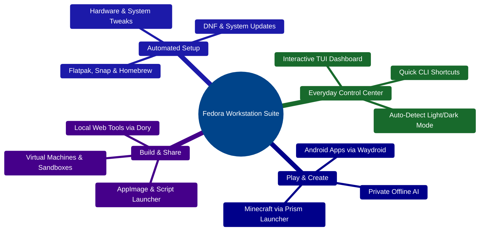
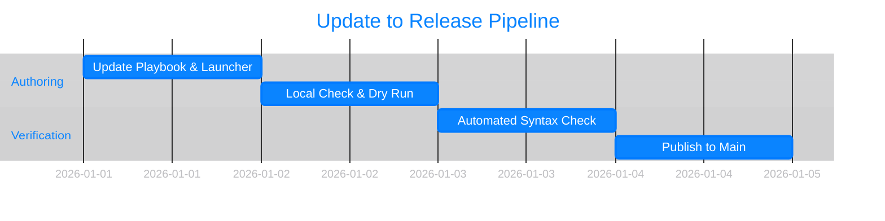

&lt;div align=&quot;center&quot;&gt;

[](#what-is-this-project)

# Fedora Workstation Post-Install Suite

**Turn a fresh Fedora install into a complete, ready-to-use workstation in minutes — no manual tweaking required.**

[License](https://www.google.com/search?q=LICENSE)
[](#development-workflow)
[](#how-it-works)
[](#architecture)
[](#how-to-run-locally)

[Quick Start](#how-to-run-locally) • [Architecture](#architecture) • [Capabilities](#how-it-works) • [Structure](#repository-structure) • [Workflow](#development-workflow)

&lt;/div&gt;

> [!NOTE]
> **All-in-One Setup & Control Center:** `local.yml` provisions your system once, while `./launcher.sh` gives you an everyday, menu-driven dashboard inspired by Apple Human Interface Guidelines.

## What Is This Project?

**Fedora Workstation Post-Install Suite** is an all-in-one setup assistant and everyday **Control Center (`launcher.sh`)** for Fedora Linux.

Instead of spending hours hunting down installers, tweaking system settings, or memorizing terminal commands, you get a single automated setup followed by a clean, menu-driven dashboard. Whether you want creative apps, Android apps on your desktop, virtual machines, or private offline AI tools, everything is organized into simple, guided choices.

| Benefit | How It Helps |
| :--- | :--- |
| **⏱️ Saves Hours of Setup** | Installs core apps, Flatpaks, Snaps, Homebrew tools, and system updates in a single pass. |
| **🧭 Keeps Things Simple** | Replaces complex terminal commands with clean, interactive menus you navigate with &lt;kbd&gt;↑&lt;/kbd&gt; &lt;kbd&gt;↓&lt;/kbd&gt; and &lt;kbd&gt;Enter&lt;/kbd&gt;. |
| **🎛️ Respects Your Choices** | Run everything at once, pick individual roles, or customize paths and themes at the top of `launcher.sh`. |

## Architecture

The diagram below shows how the suite separates behind-the-scenes system setup from your everyday Control Center:



## How It Works

Each role in `local.yml` and each module in `launcher.sh` works together to cover your entire workstation:

| Capability | What It Does | Key Component |
| :--- | :--- | :--- |
| **Fedora Apps & System** | Configures DNF, Flatpak, Snap, Homebrew, and core workstation packages | `local.yml` + `roles/` |
| **VM Templates & Sandboxes** | Pre-built Android, Linux & Windows VM definitions (`virt-builder`) | `vms/` |
| **Android Desktop** | Runs Android apps and manages GPU/ARM compatibility scripts | `waydroid/` + `--waydroid` |
| **AppImage Manager** | Scans and launches portable `.AppImage` apps and custom scripts | `--appimages` |
| **Private Offline AI** | Launches local AI tools without sending data to the cloud | `--localai` |
| **Everyday Control Center** | Unified menu with Light/Dark mode and one-word CLI shortcuts | `./launcher.sh` |

## Repository Structure

&lt;details&gt;
&lt;summary&gt;&lt;strong&gt;Explore the full project layout&lt;/strong&gt;&lt;/summary&gt;

```text
Ansible-Playbook-Fedora-Workstation/
├── launcher.sh                 # Interactive TUI Control Center & CLI shortcuts
├── local.yml                   # Master Ansible playbook for workstation provisioning
├── inventory                   # Localhost inventory target
├── roles/                      # Modular Ansible roles (apps, updates, tools)
├── vms/                        # Ready-to-import Android, Linux & Windows VM templates
├── waydroid/                   # Waydroid helper scripts & GPU tools
├── logs/                       # Setup logs
├── travis.yml                  # Automated syntax checks
├── LICENSE                     # Mozilla Public License 2.0
└── Readme.md                   # You are here
```

&lt;/details&gt;

## Development Workflow

This timeline shows how updates are tested and delivered safely:



## How to Run Locally

> [!TIP]
> **Option A — Fast One-Line Setup (Recommended):** Run this in your Fedora terminal to download everything and open the Control Center automatically:
> ```bash
> curl -SL https://github.com/AIJosue/Ansible-Playbook-Fedora-Workstation/raw/refs/heads/main/launcher.sh | bash
> ```

&lt;details open&gt;
&lt;summary&gt;&lt;strong&gt;Option B — Step-by-Step Setup &amp;amp; Customization&lt;/strong&gt;&lt;/summary&gt;

1. **Install prerequisites** (`ansible`, `git`, and `gum` for the menus):
   ```bash
   sudo dnf install -y ansible git gum
   ```

2. **Download the project**:
   ```bash
   git clone https://github.com/AIJosue/Ansible-Playbook-Fedora-Workstation.git
   cd Ansible-Playbook-Fedora-Workstation
   ```

3. **Run the automated workstation setup**:
   ```bash
   ansible-playbook local.yml --ask-become-pass
   ```
   > Want only one part, like `ujust`? Run `ansible-playbook local.yml --tags ujust --ask-become-pass`.

4. **Open the Control Center anytime**:
   ```bash
   ./launcher.sh
   ```
   > Run `./launcher.sh --help` for quick shortcuts like `--appimages`, `--waydroid`, `--dory`, `--prism`, `--localai`, `--virt-builder`, and `--ujust`.

### Customizing Your Setup

Want your AppImages, VMs, or scripts stored in different folders, or prefer Light Mode? Open the **User Configuration** section at the very top of `launcher.sh` and change any value—or override it for a single run:

```bash
APPIMAGES_DIR=/opt/AppImages HIG_APPEARANCE=light ./launcher.sh
```

&lt;/details&gt;

## License

This project is licensed under the [Mozilla Public License Version 2.0](https://www.google.com/search?q=LICENSE).
